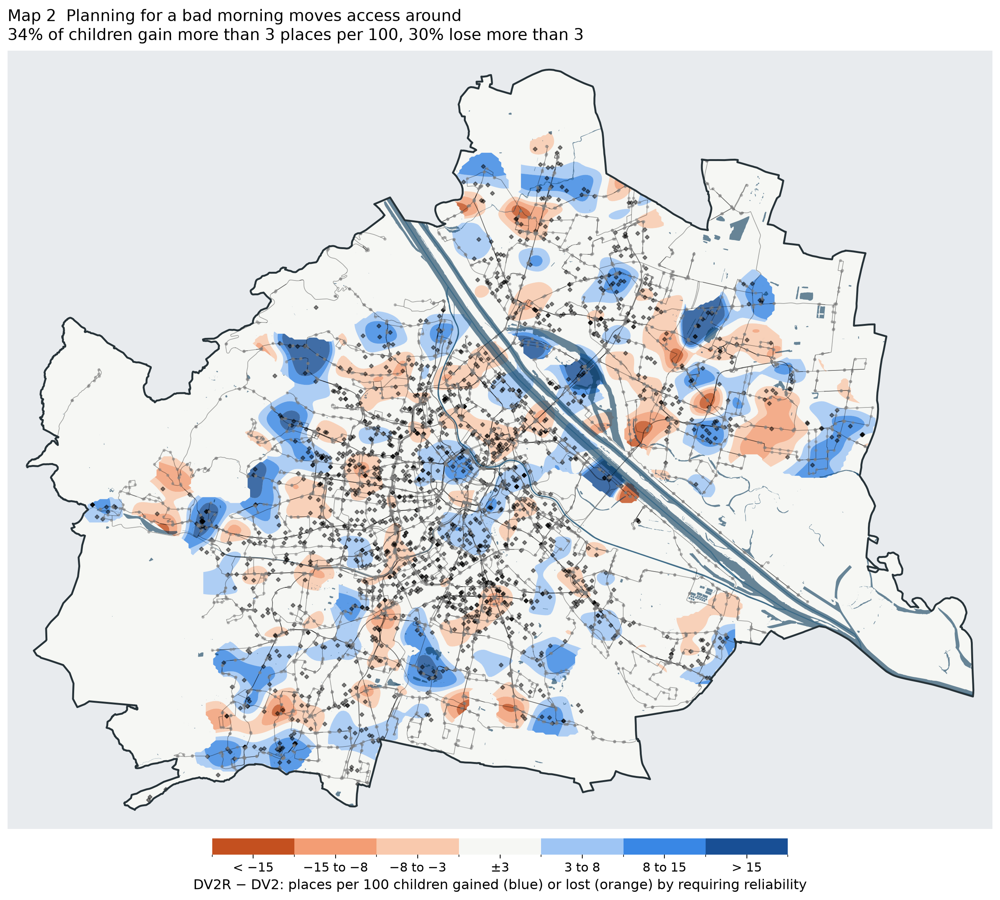
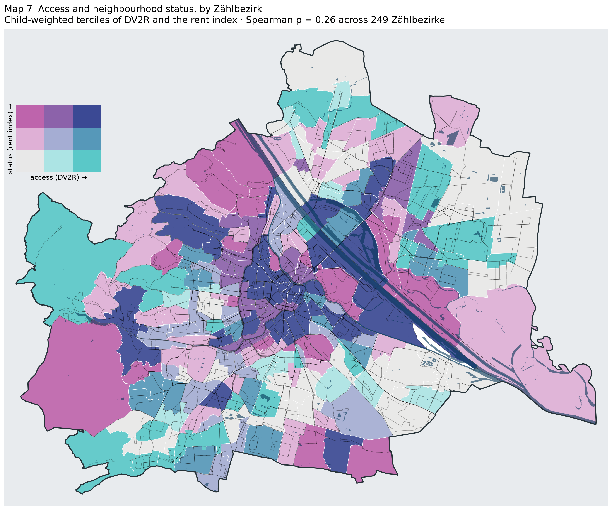

# Childcare accessibility in Vienna

This project examines whether access to childcare by walking and public transport differs with neighbourhood socio-economic status in Vienna. It replicates and extends Pennerstorfer & Pennerstorfer (2021) with a timetable-based, **reliability-adjusted two-step floating catchment area (2SFCA)** measure, computed from 60 one-minute departures (07:30–08:29, Tuesday 20 October 2026) for 6,950 cells of 250 m and 1,682 childcare sites.

*Final project, Introduction to Computational Social Science.*


## Principal results (20 November 2026)

- **Primary measure.** DV2R is a network 2SFCA evaluated at each cell–site pair's 90th-percentile travel time, the time on which a parent can rely at nine of ten departures. Its child-weighted mean is 80 places per 100 children aged 0–5.
- **Status gradient.** A one standard deviation higher neighbourhood status is associated with +0.08 to +0.10 standard deviations of DV2R (approximately +4 places per 100 children), net of density and controls (p ≤ 0.01), for all four status measures.
- **Provider type.** The gradient is driven by private sites (β ≈ +0.19 to +0.28); access to public sites is oriented towards lower-status areas (β ≈ −0.06 to −0.15).
- **Reliability.** Requiring reliability reduces the number of cell–site pairs within 15 minutes by 19% but redistributes rather than reduces access (map 2).

Hypotheses, the current status, outstanding work and limitations are set out in `docs/socioeconomic_analysis_roadmap.md`.

## Reproducing the analysis

```bash
pip install geopandas matplotlib scipy statsmodels nbformat jupyter
python get_data.py                       # downloads the 60 travel-time matrices (85 MB) from the GitHub release
cd analysis
jupyter notebook
```

The notebooks run in the following order. Each reads only the outputs of the preceding notebooks, so the analysis can be resumed at any step:

| Notebook | What it does | Runtime |
|---|---|---|
| `routing.ipynb` | Travel times by walk + public transport, every cell to every site, every minute 07:30–08:29 → `outputs/origin_destination_matrices_1min/`, plus the cell and site ids and a per-cell nearest-site summary | ~20 s with the downloaded matrices; routing from scratch takes ~3 h (`python get_data.py --routing`, r5py 1.1.7, Java 21) |
| `socioeconomic_eda.ipynb` | Children per cell, the four status measures and the controls → `Data/socioeconomic/processed/` | ~20 s |
| `accessibility_analysis.ipynb` | Access measures (DV1, DV2R, DV2, DV3), regressions, figures 1–9 → `outputs/analysis/` | ~1 min, ~4 GB RAM |
| `access_maps.ipynb` | Presentation maps: travel time, reliability, DV2R, public vs private, access × status → `outputs/maps/` | ~20 s |

Each notebook is generated from a script in `analysis/Data/socioeconomic/scripts/*_source.py` by `py_to_ipynb.py`. Changes should be made in the script, after which the notebook is regenerated and executed.

## Variables

Distributions of the main variables, weighted by the number of children aged 0–5. Maps show each variable at its native spatial level; histograms show its distribution across children, with dashed lines at the child-weighted tercile boundaries used in the analysis.

**Demand: children aged 0–5 per km²** (250 m cells; official Zählsprengel counts allocated over the 100 m resident grid)


**Neighbourhood status:** share of 25–64-year-olds with a tertiary degree and mean net income (23 districts), share of employed residents in knowledge-intensive sectors (Zählsprengel), and asking rent per m² for a standard flat (Zählsprengel)


**Controls:** share of foreign-born residents aged 15–64 (Zählbezirk), employment rate aged 15–64 (Zählsprengel), and municipal housing dwellings per 100 residents (Zählbezirk; robustness only)


Correlations, tercile maps and tercile profiles are in `analysis/outputs/eda_socioeconomic/`; their construction is documented in `analysis/socioeconomic_eda.ipynb`.

## Maps

| | |
|---|---|
|  |  |
| **1** Median travel time to the nearest site | **2** Redistribution of access under the reliability requirement (DV2R − DV2) |
|  |  |
| **6** Public and private provision | **7** Access × neighbourhood status, by Zählbezirk |

Further maps are in `analysis/outputs/maps/`; the analysis figures are in `analysis/outputs/analysis/`.

## Documents

| | |
|---|---|
| `docs/socioeconomic_analysis_roadmap.md` | Project overview: hypotheses, status, results, work plan and limitations |
| `docs/data_inventory.md` | Every dataset: core, supporting or unused, and whether it is in this repository |
| `docs/methods_primer.md` | Definitions of the measures and methods: 2SFCA, DV2R and DV2, dasymetric mapping, concentration index, MAUP |
| `docs/explanatory_models_primer.md` | Choice of regression models |
| `docs/data_sources_and_merging_guide.md` | Where the data came from and how the geographies were merged |
| `docs/rent_measure_reference.md` | How the rent-based status measure was built |

Paths in the documents are relative to `analysis/`, referred to there as the project folder.

## Data and licences

| Data | Source | Licence | Where |
|---|---|---|---|
| Childcare sites (`KINDERGARTENOGD`), district, Zählbezirk and Gemeindebau boundaries | Stadt Wien, data.wien.gv.at | CC BY 4.0 | repo |
| Population, births, education, income (MA 23) | Stadt Wien – Wirtschaft, Arbeit und Statistik | CC BY 4.0 | repo |
| Zählsprengel ages and employment, 100 m resident grid, Zählsprengel boundaries, 250 m grid | Statistik Austria (open data) | CC BY 4.0 | repo / release (grid) |
| Timetable (GTFS) | Wiener Linien / Wiener Lokalbahnen | CC BY 4.0 | release |
| Street network, water layers | © OpenStreetMap contributors | ODbL | release / repo |
| Travel-time matrices | own routing (r5py) | — | release |
| Rent index per Zählsprengel | own calculation from willhaben.at adverts | — | repo, aggregated only |

## Not in this repository

- **Individual rental advertisements**, i.e. the scraped willhaben listings (raw and cleaned) and an earlier scrape by a classmate. The advertisements are third-party content with street-level locations; only the aggregated index per Zählsprengel (`zsp_rent_index.csv`) is shared. Its construction is documented in `scrape_willhaben.py` and `build_rent_index.py`. The EDA notebook omits the one map that requires the advertisements.
- **Superseded work:** the October routing with six departures, the corresponding analysis, and early experiments.
- **Unused raw data** (for example the JRC GHSL population grid, the Eurostat 1 km census grid and population projections), listed in `docs/data_inventory.md`.
- **Literature** (copyrighted PDFs).

## Updating the repository

The repository is the working copy of the project folder on Stash's computer. Changes there are committed and pushed automatically once an hour. Before each push, changes made on GitHub are merged in, so contributions from other team members are preserved. To contribute:

1. Clone the repository (or `git pull` before starting work).
2. Commit and push changes as usual.
3. Avoid editing the same notebook at the same time as another team member: notebooks do not merge cleanly. If an automatic update meets a conflicting change, it stops and reports the conflict instead of overwriting it.
