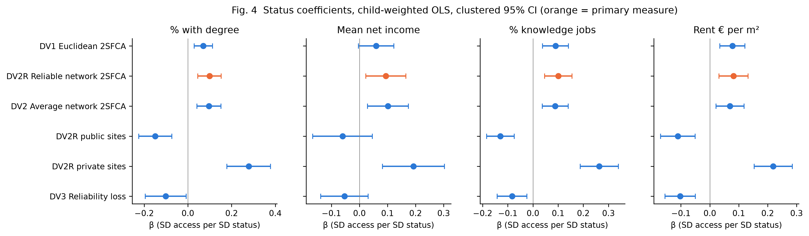
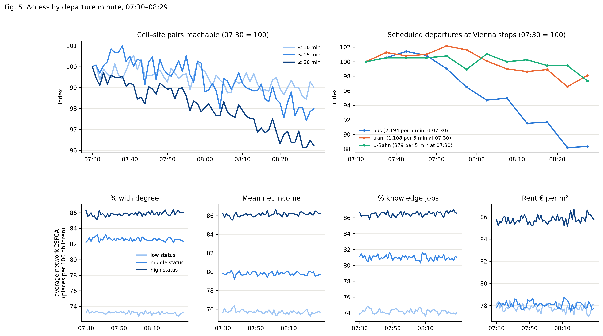
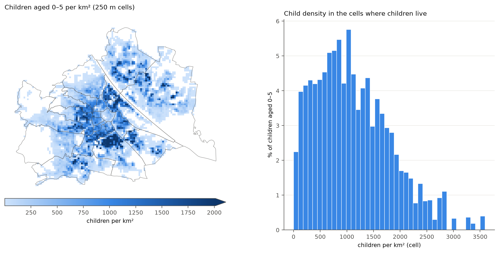
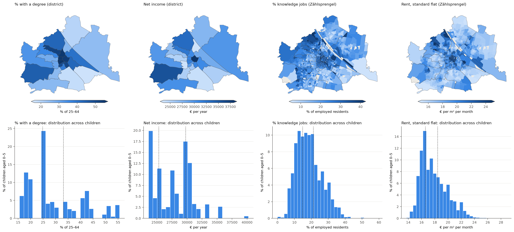
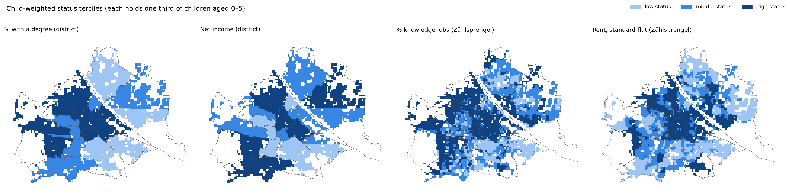
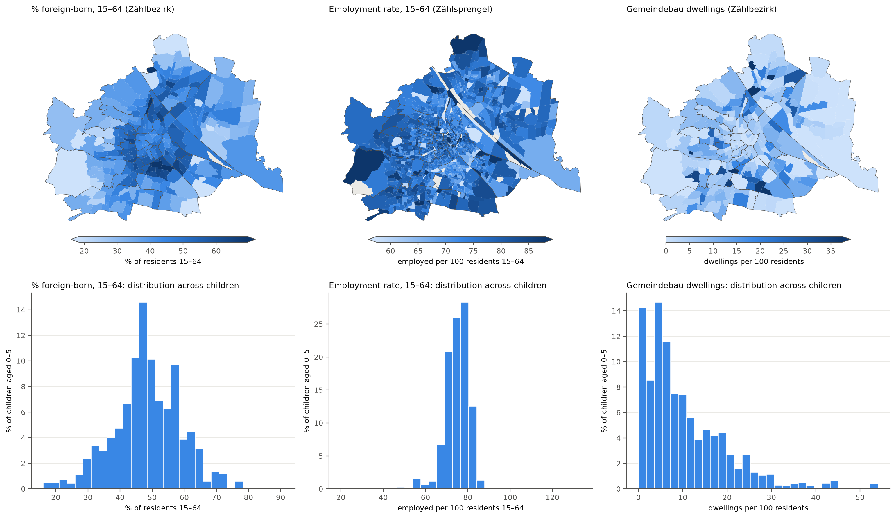
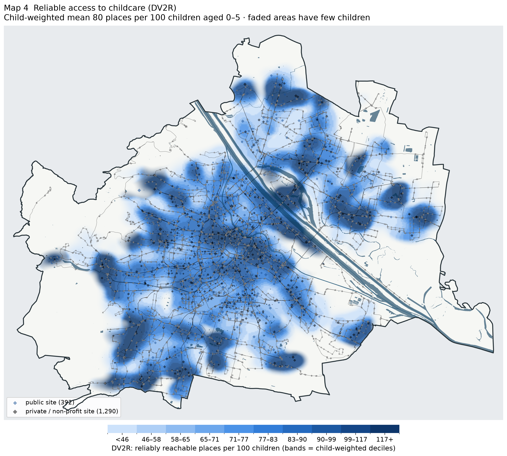
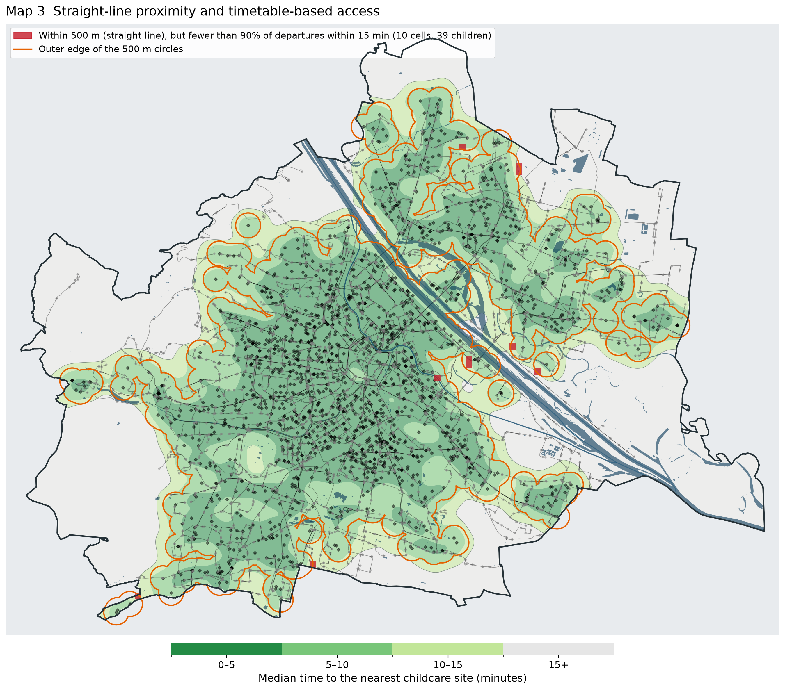

# Childcare accessibility in Vienna: a replication and extension

This project replicates and extends [Pennerstorfer & Pennerstorfer (2021)](https://doi.org/10.1017/S0047279419000990), *Inequalities in spatial accessibility of childcare: The role of non-profit providers* (Journal of Social Policy). The original study found that spatial accessibility of childcare in Vienna is highest in neighbourhoods with the highest socio-economic status, and that this inequality is attributable to non-profit providers.

The **replication** re-estimates the original design: a straight-line 2SFCA, child-weighted OLS with clustered standard errors, and separate models for public and non-profit providers. It uses current open data for 2026 in place of the paid and proprietary data of the original. The **extension** replaces straight-line distance with travel times by walking and public transport from the timetable, computed for 60 one-minute departures (07:30–08:29, Tuesday 20 October 2026), 6,950 cells of 250 m and 1,682 childcare sites. It then asks whether conclusions change when access is measured by the travel time on which parents can rely, a **reliability-adjusted 2SFCA**.

*Final project, Introduction to Computational Social Science.*


*Median travel time from each 250 m cell to the nearest childcare site, by walking and public transport, over 60 departures between 07:30 and 08:29.*

## Replication and extension

| | Pennerstorfer & Pennerstorfer (2021) | Replication (this project) | Extension (this project) |
|---|---|---|---|
| Period | Annual panel, 2007–2014 | Cross-section, 2026 | Cross-section, 2026 |
| Demand | Children under six per 250 m cell (Statistik Austria, paid) | Official Zählsprengel counts of children aged 0–5, allocated to 250 m cells via the 100 m resident grid (open data) | As replication |
| Supply | Childcare centres; capacity as number of groups | 1,682 sites (`KINDERGARTENOGD`); capacity as places | As replication |
| Accessibility | 2SFCA, straight-line distance within 500 m, decay d⁻² | **DV1:** the same specification | **DV2:** network 2SFCA on timetable travel times (Gaussian decay to 15 min), averaged over 60 departures. **DV2R:** evaluated at each pair's 90th-percentile travel time (primary outcome). **DV3:** share of access lost at an unfavourable departure |
| Neighbourhood status | Education (250 m cell), income (district), house prices (Zählsprengel, proprietary) | Education and income (district), rent per m² of a standard flat (Zählsprengel, own index from asking rents) | Adds the share of employed residents in knowledge-intensive sectors (Zählsprengel) |
| Controls | Country of birth, female employment rate (cell), U-Bahn station | Share foreign-born (Zählbezirk), employment rate (Zählsprengel), U-Bahn station, child density | Municipal housing as a robustness control |
| Model | OLS, one observation per child, standard errors clustered at the level of the status measure; separate models by provider type | Child-weighted OLS with the same clustering; public and private providers separately | As replication, for each access measure |

**Replication outcome.** The central finding is reproduced with 2026 open data. Under the original straight-line measure (DV1), access rises with neighbourhood status (β ≈ +0.06 to +0.09 standard deviations per standard deviation of status; p ≤ 0.001 except for income, p = 0.06). Consistent with the original attribution to non-profit providers, the provider-specific models (estimated on DV2R) show that the gradient arises from private, predominantly non-profit sites, while access to public sites is oriented towards lower-status areas.

## Principal results of the extension (20 November 2026)

- **Primary measure.** DV2R is a network 2SFCA evaluated at each cell–site pair's 90th-percentile travel time, the time on which a parent can rely at nine of ten departures. Its child-weighted mean is 80 places per 100 children aged 0–5.
- **Status gradient.** The direction of the original finding holds under timetable-based measures. A one standard deviation higher neighbourhood status is associated with +0.08 to +0.10 standard deviations of DV2R (approximately +4 places per 100 children), net of density and controls (p ≤ 0.01), for all four status measures.
- **Provider type.** The gradient is driven by private sites (β ≈ +0.19 to +0.28); access to public sites is oriented towards lower-status areas (β ≈ −0.06 to −0.15).
- **Measurement matters for who is counted as well served.** Straight-line and reliable network access rank cells differently (Spearman ρ = 0.72; 32% of children move by more than 25 percentiles), and the difference is itself patterned by status: higher-status areas gain rank under DV2R.
- **Reliability.** Requiring reliability reduces the number of cell–site pairs within 15 minutes by 19% but redistributes rather than reduces access (map 2). Higher-status areas lose less access at an unfavourable departure (DV3).

Hypotheses, the current status, outstanding work and limitations are set out in `docs/socioeconomic_analysis_roadmap.md`.

## Results in figures

**Status coefficients.** Each point is the coefficient of one status measure (columns) in a child-weighted OLS model of one access measure (rows), in standard deviations of access per standard deviation of status, with 95% confidence intervals clustered at the level of the status measure. Points to the right of zero indicate that access is higher in higher-status neighbourhoods. The gradient is positive for overall access under every specification, positive for private sites, and negative for public sites; higher-status areas also lose less access at an unfavourable departure (DV3).



**Public and private provision.** Reliable access (DV2R) computed separately for the 392 public sites (29 places per 100 children) and the 1,290 private sites (51 places per 100 children), most of which are run by non-profit organisations. Private provision is concentrated in the inner districts and the higher-status west and south-west; public provision is spread more evenly and is relatively stronger in the outer districts north of the Danube and in the south.


**Access by departure minute.** Top left: the number of cell–site pairs reachable within 10, 15 and 20 minutes, indexed to 07:30. Top right: scheduled departures by mode at Vienna stops. Bottom: average network access by status tercile at each departure. Bus frequency falls by about 12% over the hour and the number of pairs reachable within 20 minutes by about 4%, but the gap between low- and high-status areas is stable from minute to minute: the status gradient is not an artefact of the chosen departure time.



## Reproducing the analysis

```bash
pip install geopandas matplotlib scipy statsmodels nbformat jupyter
python get_data.py                       # downloads the 60 travel-time matrices (85 MB) from the GitHub release
cd analysis
jupyter notebook
```

The notebooks run in the following order. Each reads only the outputs of the preceding notebooks, so the analysis can be resumed at any step:

| Notebook | What it does | Runtime |
|---|---|---|
| `routing.ipynb` | Travel times by walk + public transport, every cell to every site, every minute 07:30–08:29 → `outputs/origin_destination_matrices_1min/`, plus the cell and site ids and a per-cell nearest-site summary | ~20 s with the downloaded matrices; routing from scratch takes ~3 h (`python get_data.py --routing`, r5py 1.1.7, Java 21) |
| `socioeconomic_eda.ipynb` | Children per cell, the four status measures and the controls → `Data/socioeconomic/processed/` | ~20 s |
| `accessibility_analysis.ipynb` | Access measures (DV1, DV2R, DV2, DV3), regressions, figures 1–9 → `outputs/analysis/` | ~1 min, ~4 GB RAM |
| `access_maps.ipynb` | Presentation maps: travel time, reliability, DV2R, public vs private, access × status → `outputs/maps/` | ~20 s |

Each notebook is generated from a script in `analysis/Data/socioeconomic/scripts/*_source.py` by `py_to_ipynb.py`. Changes should be made in the script, after which the notebook is regenerated and executed.

## Variables

Distributions of the main variables, weighted by the number of children aged 0–5. Maps show each variable at its native spatial level; histograms show its distribution across children, with dashed lines at the child-weighted tercile boundaries used in the analysis.

**Where children live: children aged 0–5 per km²** (250 m cells; official Zählsprengel counts allocated over the 100 m resident grid)



**Neighbourhood status:** share of 25–64-year-olds with a tertiary degree and mean net income (23 districts), share of employed residents in knowledge-intensive sectors (Zählsprengel), and asking rent per m² for a standard flat (Zählsprengel)



**Status terciles.** Each status measure is divided into child-weighted terciles, so that each tercile contains one third of children aged 0–5. The two district-level measures produce large uniform blocks; the Zählsprengel-level measures show variation within districts.



**Controls:** share of foreign-born residents aged 15–64 (Zählbezirk), employment rate aged 15–64 (Zählsprengel), and municipal housing dwellings per 100 residents (Zählbezirk; robustness only)



Correlations, tercile maps and tercile profiles are in `analysis/outputs/eda_socioeconomic/`; their construction is documented in `analysis/socioeconomic_eda.ipynb`.

## Maps

| | |
|---|---|
|  |  |
| **4** Reliable access to childcare (DV2R), places per 100 children | **3** Straight-line distance compared with timetable travel time |

Further maps are in `analysis/outputs/maps/`; the analysis figures are in `analysis/outputs/analysis/`.

## Documents

| | |
|---|---|
| `docs/socioeconomic_analysis_roadmap.md` | Project overview: hypotheses, status, results, work plan and limitations |
| `docs/data_inventory.md` | Every dataset: core, supporting or unused, and whether it is in this repository |
| `docs/methods_primer.md` | Definitions of the measures and methods: 2SFCA, DV2R and DV2, dasymetric mapping, concentration index, MAUP |
| `docs/explanatory_models_primer.md` | Choice of regression models |
| `docs/data_sources_and_merging_guide.md` | Where the data came from and how the geographies were merged |
| `docs/rent_measure_reference.md` | How the rent-based status measure was built |

Paths in the documents are relative to `analysis/`, referred to there as the project folder.

## Data and licences

| Data | Source | Licence | Where |
|---|---|---|---|
| Childcare sites (`KINDERGARTENOGD`), district, Zählbezirk and Gemeindebau boundaries | Stadt Wien, data.wien.gv.at | CC BY 4.0 | repo |
| Population, births, education, income (MA 23) | Stadt Wien – Wirtschaft, Arbeit und Statistik | CC BY 4.0 | repo |
| Zählsprengel ages and employment, 100 m resident grid, Zählsprengel boundaries, 250 m grid | Statistik Austria (open data) | CC BY 4.0 | repo / release (grid) |
| Timetable (GTFS) | Wiener Linien / Wiener Lokalbahnen | CC BY 4.0 | release |
| Street network, water layers | © OpenStreetMap contributors | ODbL | release / repo |
| Travel-time matrices | own routing (r5py) | — | release |
| Rent index per Zählsprengel | own calculation from willhaben.at adverts | — | repo, aggregated only |

## Not in this repository

- **Individual rental advertisements**, i.e. the scraped willhaben listings (raw and cleaned) and an earlier scrape by a classmate. The advertisements are third-party content with street-level locations; only the aggregated index per Zählsprengel (`zsp_rent_index.csv`) is shared. Its construction is documented in `scrape_willhaben.py` and `build_rent_index.py`. The EDA notebook omits the one map that requires the advertisements.
- **Superseded work:** the October routing with six departures, the corresponding analysis, and early experiments.
- **Unused raw data** (for example the JRC GHSL population grid, the Eurostat 1 km census grid and population projections), listed in `docs/data_inventory.md`.
- **Literature** (copyrighted PDFs).

## Updating the repository

The repository is the working copy of the project folder on Stash's computer. Changes there are committed and pushed automatically once an hour. Before each push, changes made on GitHub are merged in, so contributions from other team members are preserved. To contribute:

1. Clone the repository (or `git pull` before starting work).
2. Commit and push changes as usual.
3. Avoid editing the same notebook at the same time as another team member: notebooks do not merge cleanly. If an automatic update meets a conflicting change, it stops and reports the conflict instead of overwriting it.

## References

Pennerstorfer, A., & Pennerstorfer, D. (2021). Inequalities in spatial accessibility of childcare: The role of non-profit providers. *Journal of Social Policy*, 50(1), 122–147. https://doi.org/10.1017/S0047279419000990

Pennerstorfer, A., Pennerstorfer, D., & Neumayr, M. (2025). Unequal access to childcare in cities: Is equal public funding sufficient? *Urban Studies*, 62(4), 647–664. https://doi.org/10.1177/00420980241258298
