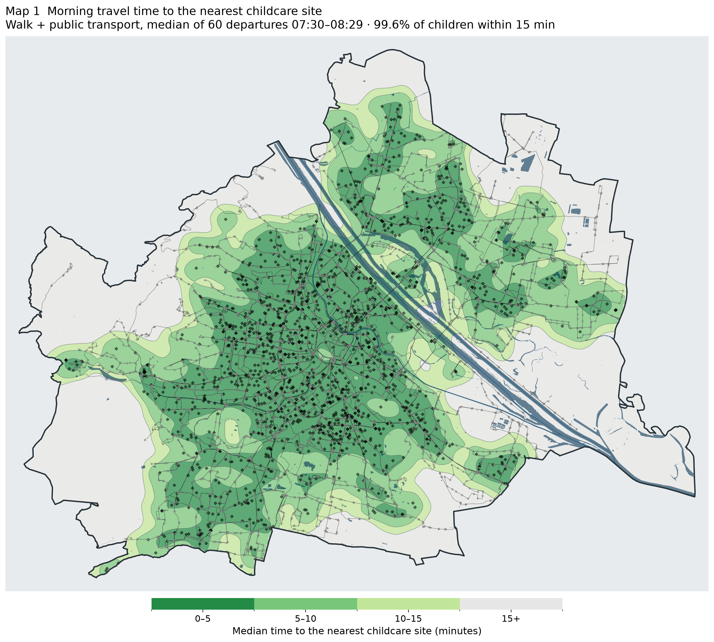
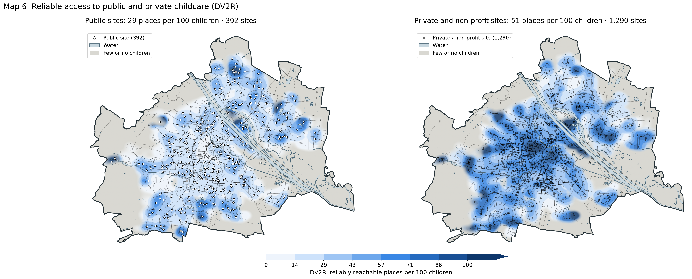

# Childcare accessibility in Vienna

Does access to childcare by public transport differ with neighbourhood status in Vienna? This project replicates and extends Pennerstorfer & Pennerstorfer (2021). It uses a timetable-based, **reliability-adjusted 2SFCA** built from 60 one-minute departures (07:30–08:29, Tue 20 Oct 2026), measured for 6,950 cells of 250 m and 1,682 childcare sites.

*Intro to Computational Social Science, final project.*


## Key results so far (20 Nov 2026)

- **Primary measure: DV2R.** This is a network 2SFCA on each pair's 90th-percentile travel time, i.e. the time a parent can count on 9 mornings in 10. Across the city it averages 80 places per 100 children aged 0–5.
- **Higher status goes with more access.** One SD more status means about +0.08 to +0.10 SD more DV2R (about +4 places per 100 children), net of density and controls (p ≤ 0.01). This holds for all four status measures.
- **Private sites drive that gap.** Their coefficient is about +0.19 to +0.28. Public sites lean towards lower-status areas (about −0.06 to −0.15).
- **Requiring reliability moves access around more than it removes it.** It cuts the cell–site pairs within 15 min by 19%, but the places go to different children rather than disappearing (map 2).

The full status, open tasks and caveats are in `docs/socioeconomic_analysis_roadmap.md`.

## Quick start

```bash
pip install geopandas matplotlib scipy statsmodels nbformat jupyter
python get_data.py                       # downloads the 60 travel-time matrices (85 MB) from the GitHub release
cd analysis
jupyter notebook
```

The notebooks run in this order. Each one only reads what the ones before it saved, so you can start at any of them:

| Notebook | What it does | Runtime |
|---|---|---|
| `routing.ipynb` | Travel times by walk + public transport, every cell to every site, every minute 07:30–08:29 → `outputs/origin_destination_matrices_1min/`, plus the cell and site ids and a per-cell nearest-site summary | ~20 s with the downloaded matrices; routing from scratch takes ~3 h (`python get_data.py --routing`, r5py 1.1.7, Java 21) |
| `socioeconomic_eda.ipynb` | Children per cell, the four status measures and the controls → `Data/socioeconomic/processed/` | ~20 s |
| `accessibility_analysis.ipynb` | Access measures (DV1, DV2R, DV2, DV3), regressions, figures 1–9 → `outputs/analysis/` | ~1 min, ~4 GB RAM |
| `access_maps.ipynb` | Presentation maps: travel time, reliability, DV2R, public vs private, access × status → `outputs/maps/` | ~20 s |

Each notebook is generated from a script in `analysis/Data/socioeconomic/scripts/*_source.py` (`py_to_ipynb.py` converts them). Edit the script, regenerate, then run.

## Maps

| | |
|---|---|
|  |  |
| **1** Median travel time to the nearest site | **2** Who gains / loses places when parents plan for a bad morning (DV2R − DV2) |
|  |  |
| **6** Public vs private provision | **7** Access × neighbourhood status, by Zählbezirk |

The rest are in `analysis/outputs/maps/` and `analysis/outputs/analysis/`.

## Documents

| | |
|---|---|
| `docs/socioeconomic_analysis_roadmap.md` | Status, key results, phases and what is still open |
| `docs/data_inventory.md` | Every dataset: core, supporting or unused, and whether it is in this repository |
| `docs/methods_primer.md` | Plain-language glossary: 2SFCA, DV2R vs DV2, dasymetric mapping, concentration index, MAUP … |
| `docs/explanatory_models_primer.md` | Which regression models are used and why |
| `docs/data_sources_and_merging_guide.md` | Where the data came from and how the geographies were merged |
| `docs/rent_measure_reference.md` | How the rent-based status measure was built |

Paths in the docs are relative to `analysis/` (the docs call it the project folder).

## Data and licences

| Data | Source | Licence | Where |
|---|---|---|---|
| Childcare sites (`KINDERGARTENOGD`), district, Zählbezirk and Gemeindebau boundaries | Stadt Wien, data.wien.gv.at | CC BY 4.0 | repo |
| Population, births, education, income (MA 23) | Stadt Wien – Wirtschaft, Arbeit und Statistik | CC BY 4.0 | repo |
| Zählsprengel ages and employment, 100 m resident grid, Zählsprengel boundaries, 250 m grid | Statistik Austria (open data) | CC BY 4.0 | repo / release (grid) |
| Timetable (GTFS) | Wiener Linien / Wiener Lokalbahnen | CC BY 4.0 | release |
| Street network, water layers | © OpenStreetMap contributors | ODbL | release / repo |
| Travel-time matrices | own routing (r5py) | — | release |
| Rent index per Zählsprengel | own calculation from willhaben.at adverts | — | repo, aggregated only |

## Not in this repository

- **Individual rental adverts.** That means the scraped willhaben listings (raw and cleaned) and an earlier scrape by a classmate. Adverts are third-party content with street-level locations, so only the per-Zählsprengel index (`zsp_rent_index.csv`) is shared. `scrape_willhaben.py` and `build_rent_index.py` show how it was built. The EDA notebook skips the one map that needs the adverts.
- **Superseded work:** the October 6-departure routing and analysis, and early experiments.
- **Unused raw data** (e.g. JRC GHSL population, Eurostat 1 km census grid, population projections). `docs/data_inventory.md` lists them.
- **Literature PDFs** (copyrighted).
